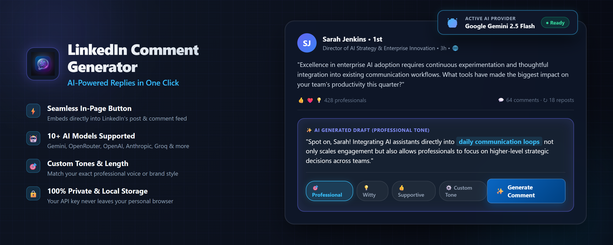
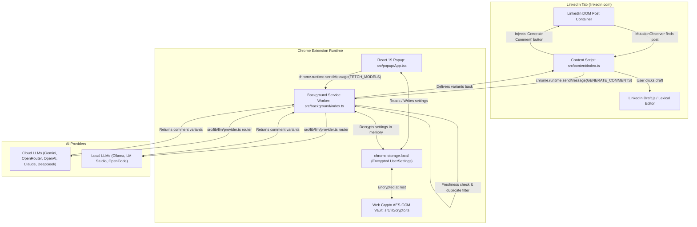

# LinkedIn Comment Generator 🚀



[](https://github.com/ronisarkar-official/linkedin-comment-generator/releases/latest) [](https://github.com/ronisarkar-official/linkedin-comment-generator/blob/main/LICENSE) [](https://developer.chrome.com/docs/extensions/mv3/) [](https://www.typescriptlang.org/) [](https://vitest.dev/) [](https://developer.mozilla.org/en-US/docs/Web/API/SubtleCrypto)

<br />
<div align="center">
<a href="https://www.producthunt.com/products/linkedin-comment-generator?embed=true&amp;utm_source=badge-featured&amp;utm_medium=badge&amp;utm_campaign=badge-linkedin-comment-generator" target="_blank" rel="noopener noreferrer"></a>
</div>

<br />

**LinkedIn Comment Generator** is a lightweight, privacy-first, open-source browser extension built on Chrome Manifest V3. Designed for professionals, creators, and developers, it brings multi-provider AI comment generation directly into your LinkedIn feed. Generate authentic, high-signal comments in your personal voice, evaluate multiple thoughtful draft variants, and insert them into LinkedIn's active editor with a single click.

[**Install from Microsoft Edge Add-ons**](https://microsoftedge.microsoft.com/addons/detail/linkedin-comment-generato/bgnnpcjchmccpijnlmpnciceabogpmpg) • [**Report an Issue**](https://github.com/ronisarkar-official/linkedin-comment-generator/issues) • [**Request a Feature**](https://github.com/ronisarkar-official/linkedin-comment-generator/issues) • [**Support / Donate**](#-support--donate)

---

## 🎬 Demo: How It Works

<div align="center">
  <video 
    src="https://ik.imagekit.io/2zeqzsn1n/lcg-video-ezgif.com-gif-to-mp4-converter.mp4?tr=w-900,q-70" 
    poster="https://ik.imagekit.io/2zeqzsn1n/lcg-video-ezgif.com-gif-to-mp4-converter.mp4/ik-thumbnail.jpg" 
    controls="controls" 
    width="100%" 
    style="max-width: 900px; border-radius: 12px; border: 1px solid #e2e8f0; box-shadow: 0 8px 30px rgba(0, 0, 0, 0.12);">
    Your browser does not support the video tag.
  </video>
  <p><sub><a href="https://ik.imagekit.io/2zeqzsn1n/lcg-video-ezgif.com-gif-to-mp4-converter.mp4" target="_blank" rel="noopener noreferrer">▶️ Direct link to watch/download demo video (MP4)</a></sub></p>
</div>

---

## 🌟 Built on Trust, Privacy & Freedom

LinkedIn Comment Generator is engineered with an uncompromising commitment to security, user ownership, and code transparency:

- 🛡️ **Direct-to-Provider Architecture:** Every request communicates directly from your browser runtime to your chosen AI provider (or localhost). There are **zero intermediary servers**, zero proxy relays, and zero telemetry tracking.
- 🔐 **Native Web Crypto Security (AES-GCM-256):** All sensitive API keys in local storage are encrypted at rest using native browser Web Crypto (`crypto.subtle`). Your credentials remain completely under your control and never leave your device unencrypted.
- 💻 **First-Class Local AI & Zero Billing:** Seamless native integration with **Ollama**, **LM Studio**, and **OpenCode**. Run state-of-the-art models like `llama3.2`, `deepseek-r1`, `qwen2.5`, and `mistral` 100% offline and free with live connection health probing and zero API key requirements.
- 🧠 **Intelligent Anti-Repetition Guard:** Proprietary background duplicate detection screens out repetitive clichés and generic AI openers (e.g. *"Great post!"*, *"Totally agree!"*). The system maintains a cross-post freshness pool to guarantee every comment is distinct and context-rich.
- 📊 **Pro History Dashboard & Clean CSV Analytics:** Store up to 1,000 generated drafts locally with instant search, segmented date filters (`All`, `Today`, `7 Days`, `30 Days`), and professional single-line CSV export with exact post timestamp decoding via LinkedIn Snowflake IDs.
- ⚡ **Ultra-Lightweight & Efficient:** Powered by modern Chrome Manifest V3 with an event-driven background service worker that consumes **0 MB RAM** when idle.
- 🧪 **Thoroughly Tested:** Backed by **104 automated unit and integration tests** verifying targeting, DOM isolation, cryptographic encryption, date extraction, and provider routing.

---

## ✨ Features

- 🤖 **Universal AI Provider Support:**
  - **Google Gemini** (Gemini 2.5 Flash, 2.5 Pro, 2.0 Flash — Free tier available)
  - **Ollama (Local & 100% Free)** (Completely private, on-device models like `llama3.2:3b`, `deepseek-r1:8b`, `qwen2.5:7b`, `mistral:7b`)
  - **LM Studio & LocalAI** (Local OpenAI-compatible servers on port 1234 / 8080)
  - **OpenRouter** (Unified access to hundreds of models, including open-source and free router endpoints)
  - **OpenCode** (Local / networked AI programming assistant via `opencode serve`)
  - **OpenAI** (GPT-4o, GPT-4o-mini, o3-mini, o1)
  - **Anthropic Claude** (Claude 3.7 Sonnet, Claude 3.5 Haiku, Claude 3 Opus)
  - **DeepSeek** (DeepSeek Chat V3, DeepSeek Reasoner R1)
  - **Perplexity** (Sonar, Sonar Pro with live web search grounding)
  - **xAI Grok** (Grok 2, Grok 2 Mini)
  - **Custom Endpoints** (Any OpenAI-compatible proxy, vLLM, or corporate endpoint)
- 🟢 **Live Local AI Health Probe:** Visual status indicator displaying real-time connection state, installed model count, and millisecond latency for Ollama and LM Studio.
- 📋 **One-Click Local Launch Helper:** Shows exact terminal commands (e.g., `ollama run llama3.2:3b`) with one-click copy feedback if your local model server is offline.
- 🎨 **Custom Voice & Tone Matching:** Personalize generated comments with your profile bio summary and reference writing examples. Choose from built-in tones or create unlimited custom tone personas.
- 📐 **Adjustable Length:** Generate snappy short comments (1–2 sentences), balanced medium takes (2–4 sentences), or detailed long-form analyses.
- 📣 **Customizable Promotional Signature:** Append your newsletter, portfolio, or links with exact spacing control (<kbd>Enter</kbd>, <kbd>Tab</kbd>, <kbd>Spacebar</kbd>) with zero default paragraph breaks.
- 📝 **Reliable Native Editor Injection:** Injects comments smoothly into LinkedIn's active Draft.js / Lexical comment composer with one click.
- 🔒 **Privacy-by-Design:** No user tracking, no cookies, no analytics. Uninstalling the extension completely purges all local data.

---

## 🚀 Installation

### Option 1: One-Click Store Install (Recommended)

Install directly from the [**Microsoft Edge Add-ons Store**](https://microsoftedge.microsoft.com/addons/detail/linkedin-comment-generato/bgnnpcjchmccpijnlmpnciceabogpmpg).
> Fully compatible with **Microsoft Edge**, **Google Chrome**, **Brave**, **Arc**, and all Chromium-based browsers.

### Option 2: Build & Load from Source

```bash
# 1. Clone the repository
git clone https://github.com/ronisarkar-official/linkedin-comment-generator.git
cd linkedin-comment-generator

# 2. Install dependencies
npm install

# 3. Build the production extension bundle
npm run build
```

Then load the extension into your browser:
1. Navigate to `chrome://extensions` or `edge://extensions`
2. Enable **Developer mode** (toggle in the top-right or left sidebar)
3. Click **Load unpacked** and select the generated `dist/` directory
4. Pin **LinkedIn Comment Generator** to your browser toolbar!

---

## 🧭 Quick Start Guide

1. Open the **LinkedIn Comment Generator** popup from your browser toolbar.
2. Select your preferred **AI Provider**:
   - **Google Gemini**: Get a free API key at [Google AI Studio](https://aistudio.google.com/apikey).
   - **OpenRouter**: Get an API key at [openrouter.ai/keys](https://openrouter.ai/keys) (includes free models).
   - **Ollama (Free & Offline)**: Run `ollama run llama3.2` and select your local model.
   - **LM Studio (Free & Offline)**: Start your local server in LM Studio on port 1234.
3. Personalize your default tone, length, and optional bio summary.
4. Browse [LinkedIn](https://www.linkedin.com) in your browser.
5. On any post in your feed, click the inline **Generate Comment** button to generate thoughtful draft variants!

---

## 🔌 Supported Providers & Setup

| Provider | Type | API Key Required | Default Endpoint | Security & Privacy Notes |
| :--- | :--- | :---: | :--- | :--- |
| **Ollama** | Local / Offline | **No** | `http://localhost:11434/v1` | 100% private, on-device CPU/GPU, zero cost |
| **LM Studio** | Local / Offline | **No** | `http://localhost:1234/v1` | 100% private, local server, zero cost |
| **OpenCode** | Local / Server | Optional | `http://localhost:4096` | 100% private, run via `opencode serve` |
| **Google Gemini** | Cloud | Yes (Generous Free Tier) | Google AI Studio | Fast, high-quality, generous free quota |
| **OpenRouter** | Cloud | Yes (Free models available) | `https://openrouter.ai/api/v1` | Multi-model marketplace, open-source models |
| **OpenAI** | Cloud | Yes | `https://api.openai.com/v1` | Official GPT-4o, GPT-4o-mini, o3-mini |
| **Anthropic** | Cloud | Yes | `https://api.anthropic.com/v1` | Official Claude 3.7 Sonnet, 3.5 Haiku |
| **DeepSeek** | Cloud | Yes | `https://api.deepseek.com/v1` | DeepSeek Chat V3, DeepSeek Reasoner R1 |
| **Perplexity** | Cloud | Yes | `https://api.perplexity.ai` | Web-grounded answers via Sonar models |
| **xAI Grok** | Cloud | Yes | `https://api.x.ai/v1` | Official Grok 2 & Grok 2 Mini |
| **Custom Endpoints** | Any | Optional | User configured | LocalAI, vLLM, custom corporate proxies |

---

## 🤖 AI Agent & LLM Architecture Reference

> **Context for Coding Assistants & LLMs:**
> If you are an AI assistant (Claude Code, Antigravity, ChatGPT, Cursor, Copilot, Aider) inspecting or developing within this codebase, refer to this section for structural specifications, system invariants, and data contracts.

### System Architecture Flow



### Key Files & Responsibility Map

| File Path | Responsibility & Component Boundaries |
| :--- | :--- |
| [`manifest.json`](manifest.json) | Chrome Manifest V3 manifest, permissions (`storage`, `unlimitedStorage`, `activeTab`, `scripting`), host permissions, and service worker registration. |
| [`src/content/index.ts`](src/content/index.ts) | Content script injected into LinkedIn. Manages `MutationObserver` post detection, multi-tier author name extraction, Snowflake post timestamp parsing, and inline UI rendering. |
| [`src/content/dom-selectors.ts`](src/content/dom-selectors.ts) | Safe LinkedIn DOM traversal, post container isolation, author username extraction, and Twitter Snowflake epoch timestamp decoding (`id >> 22n`). |
| [`src/content/comment-box.ts`](src/content/comment-box.ts) | Renders inline comment generation buttons and draft preview cards in the feed with zero layout shift. |
| [`src/background/index.ts`](src/background/index.ts) | Event-driven service worker. Validates incoming message contracts, manages generation history (1,000 capacity), and coordinates LLM generation. |
| [`src/lib/crypto.ts`](src/lib/crypto.ts) | Native Web Crypto `AES-GCM-256` key encryption vault. Generates device-local seeds and provides transparent encryption at rest. |
| [`src/lib/storage.ts`](src/lib/storage.ts) | Encapsulated storage layer for `chrome.storage.local`. Automatically encrypts API keys before persisting and decrypts upon retrieval. |
| [`src/lib/llm/provider.ts`](src/lib/llm/provider.ts) | Unified LLM router. Directs requests to provider clients (`gemini.ts`, `openai-compat.ts`, `anthropic.ts`, `opencode.ts`). |
| [`src/lib/llm/freshness.ts`](src/lib/llm/freshness.ts) | Duplicate comment detection, Levenshtein distance similarity scoring, opening pattern detection, and anti-repetition pool management. |
| [`src/lib/llm/local-probe.ts`](src/lib/llm/local-probe.ts) | Live local AI health probe for Ollama, LM Studio, and OpenCode with latency benchmarking and model extraction. |
| [`src/lib/csv-export.ts`](src/lib/csv-export.ts) | Single-line professional CSV export with 4-tier date resolution, exact formatting, and RFC 4180 escaping. |
| [`src/popup/App.tsx`](src/popup/App.tsx) | React 19 settings and history dashboard. Built with Tailwind CSS and Geist typography. |

### Message Passing Protocol

All cross-context communication uses strictly typed messages via `chrome.runtime.sendMessage`:

```typescript
// 1. Generate Comments (Content Script -> Background Worker)
interface GenerateCommentsMessage {
  action: 'GENERATE_COMMENTS';
  payload: {
    postText: string;
    tone: string;
    length: 'short' | 'medium' | 'long';
    authorName?: string;
    customDirective?: string;
    postDate?: string;
    postTimestamp?: number;
  };
}

// 2. Fetch Live Models (Popup -> Background Worker)
interface FetchModelsMessage {
  action: 'FETCH_MODELS';
  payload: {
    provider: LlmProvider;
    apiKey?: string;
    customApiBase?: string;
    forceRefresh?: boolean;
  };
}
```

### Security & Invariant Guarantees

1. **No External Dependencies for Core Security:** Encryption uses native `globalThis.crypto.subtle` with `AES-GCM-256` and unique 12-byte initialization vectors (IVs) per encryption operation.
2. **Deterministic Context Isolation:** Content scripts run in an isolated world and do not pollute LinkedIn's global JavaScript scope.
3. **Strict Content Security Policy:** Extension pages enforce `script-src 'self'; object-src 'self'` with zero inline `eval()` or remote code execution.

---

## 🛠️ Development & Testing

### Prerequisites
- **Node.js**: v20.19.0 or higher
- **npm**: v10.0.0 or higher

### Available Commands

```bash
npm install        # Install project dependencies
npm run dev        # Launch Vite development server with hot-reload
npm run build      # Typecheck and build production extension bundle into dist/
npm run typecheck  # Run TypeScript strict type verification (tsc --noEmit)
npm test           # Run complete Vitest suite (104 automated tests)
npm run build:zip  # Package production bundle into a clean release zip file
```

### Adding a New AI Provider

1. **Add Provider Identifier:** In [`src/lib/types.ts`](src/lib/types.ts), add the provider key to the `LlmProvider` union.
2. **Register Metadata:** In [`src/lib/llm/registry.ts`](src/lib/llm/registry.ts), add default models, API base, and key placeholders to `PROVIDERS`.
3. **Implement or Route Client:** Route the provider in [`src/lib/llm/provider.ts`](src/lib/llm/provider.ts) (e.g. leveraging `generateWithOpenAICompat` in `openai-compat.ts`).
4. **Configure Live Model Discovery:** In [`src/lib/llm/model-fetcher.ts`](src/lib/llm/model-fetcher.ts), implement the model fetching and filtering logic.
5. **Verify:** Run `npm run typecheck && npm test && npm run build`.

---

## 💖 Support & Donate

LinkedIn Comment Generator is developed and maintained as a completely free, independent, open-source project. If it saves you time or enhances your LinkedIn engagement, your support is deeply appreciated!

### ☕ Support via UPI (India)

Scan the QR code below using any UPI app (**Google Pay, PhonePe, Paytm, BHIM, CRED**):

<div align="center">
  
  <p><i>Every contribution directly supports testing, maintenance, and continuous compatibility updates!</i></p>
</div>

### 🌟 Other Ways to Support

- **Star this repository** on GitHub — it helps more professionals discover the project!
- **Write a Review** on the [Microsoft Edge Add-ons store](https://microsoftedge.microsoft.com/addons/detail/linkedin-comment-generato/bgnnpcjchmccpijnlmpnciceabogpmpg).
- **Upvote on Product Hunt**: Check out our [Product Hunt launch](https://www.producthunt.com/products/linkedin-comment-generator).
- **Share**: Mention the extension to friends and colleagues on LinkedIn and Twitter/X.

---

## 🤝 Contributing

Contributions are warmly welcomed! Whether you want to improve prompt templates, add support for a new AI model provider, optimize LinkedIn DOM selectors, or refine UI components:

1. **Fork** the repository and create your feature branch:
   ```bash
   git checkout -b feature/my-new-feature
   ```
2. **Commit** your changes with clear messages:
   ```bash
   git commit -m 'feat: add support for new provider'
   ```
3. **Verify** your changes:
   ```bash
   npm run typecheck && npm test && npm run build
   ```
4. **Push** to your branch and submit a **Pull Request**!

---

## 🔒 Privacy Commitment

- All API keys, settings, and comment history are stored exclusively on your local device in `chrome.storage.local`.
- Sensitive API keys are encrypted at rest with native `AES-GCM-256`.
- Requests travel directly from your browser to your selected AI provider — never through a middleman server.
- The extension collects zero analytics, telemetry, or user data.
- Read the complete [Privacy Policy](PRIVACY_POLICY.md) for full details.

---

## 📄 License

This project is open-source software released under the [MIT License](LICENSE).

<div align="center">
  <sub>Built with care by <a href="https://github.com/ronisarkar-official">Roni Sarkar</a> • Connect on <a href="https://www.linkedin.com/in/ronisarkar">LinkedIn</a> and <a href="https://x.com/ronisarkarDev">Twitter/X</a></sub>
</div>
