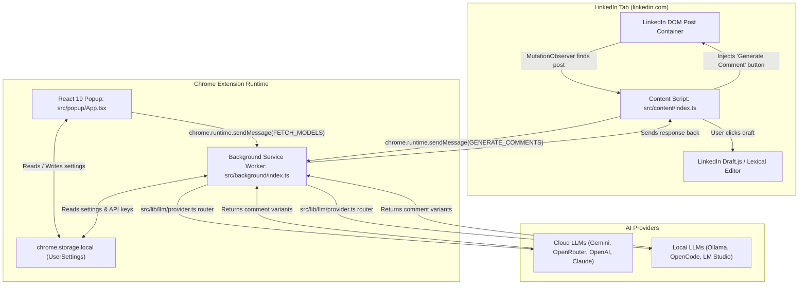

# LinkedIn Comment Generator 🚀


[](https://github.com/ronisarkar-official/linkedin-comment-generator/releases/latest) [](https://github.com/ronisarkar-official/linkedin-comment-generator/blob/main/LICENSE) [](https://developer.chrome.com/docs/extensions/mv3/)

<br />
<div align="center">
<a href="https://www.producthunt.com/products/linkedin-comment-generator?embed=true&amp;utm_source=badge-featured&amp;utm_medium=badge&amp;utm_campaign=badge-linkedin-comment-generator" target="_blank" rel="noopener noreferrer"></a>

</div>

A lightweight, privacy-first, open-source Manifest V3 browser extension that brings multi-provider AI comment generation directly into LinkedIn's post feed. It sends post text through the background service worker to your chosen AI provider (Gemini, Ollama, OpenCode, OpenRouter, OpenAI, Anthropic, and more), generates thoughtful, high-signal comment variants, and inserts your selected draft into LinkedIn's comment editor with one click.

[**Install from Microsoft Edge Add-ons**](https://microsoftedge.microsoft.com/addons/detail/linkedin-comment-generato/bgnnpcjchmccpijnlmpnciceabogpmpg) • [**Report a Bug**](https://github.com/ronisarkar-official/linkedin-comment-generator/issues) • [**Request a Feature**](https://github.com/ronisarkar-official/linkedin-comment-generator/issues) • [**Support / Donate**](#-support--donate)

---

## 🌟 Why LinkedIn Comment Generator?

Most LinkedIn extensions force you into expensive monthly subscriptions, send your browsing data to proprietary middleman servers, or lock you into a single LLM.

**LinkedIn Comment Generator is 100% free, open-source, and privacy-first:**
- **Zero Middleman Servers:** Your browser talks directly to your chosen AI provider using your own API key (BYOK) or your local offline models.
- **Run Completely Offline or Free:** Full native support for **Ollama** (offline local LLMs), **OpenCode** (`opencode serve`), **Google Gemini** (generous free tier), and **OpenRouter** (free models).
- **Near-Zero Memory Footprint:** Built on Manifest V3 with an event-driven background service worker that unloads when idle (0 MB RAM overhead when not actively generating).
- **Custom Voice & Style:** Train it with your personal tone, profile bio summary, and few-shot examples so your comments sound genuinely like you.

---

## ✨ Features

- 🤖 **Universal AI Provider Support:**
  - **Google Gemini** (Gemini 2.5 Flash, 2.0 Pro — Free tier available)
  - **OpenRouter** (Access to hundreds of cloud models, including free open-source models)
  - **Ollama** (100% offline, private, local models like `llama3.2`, `mistral`, `deepseek-r1`)
  - **OpenCode** (Local / networked AI programming assistant server `opencode serve`)
  - **OpenAI** (GPT-4o, GPT-4o-mini, o3-mini)
  - **Anthropic Claude** (Claude 3.7 Sonnet, Claude 3.5 Haiku)
  - **DeepSeek** (DeepSeek Chat V3, DeepSeek Reasoner R1)
  - **Perplexity** (Sonar, Sonar Pro with live web grounding)
  - **xAI Grok** (Grok 2, Grok 2 Vision)
  - **Custom OpenAI-Compatible Endpoints** (LocalAI, vLLM, LM Studio, custom proxy servers)
- 🔄 **Dynamic Live Model Discovery:** One-click **Refresh** button dynamically queries your provider's live models catalog with smart fallback to offline defaults.
- 🎨 **Shadcn UI & Dark/Light Theme:** Polished settings popup built with `@base-ui/react`, Tailwind CSS v4, and Geist font typography.
- 🎯 **Tone Matching & Custom Tones:** Pick from Professional, Witty, Supportive, or create your own custom prompt personas.
- 📐 **Adjustable Length:** Generate short (1-2 sentences), medium (2-4 sentences), or detailed paragraphs.
- 📝 **Native Draft Injection:** Injects comments directly into LinkedIn's active Draft.js / Lexical comment box with one click.
- 📜 **Local Generation History:** Stores your last 50 generated comments locally in `chrome.storage.local`.
- 🔒 **Privacy-by-Design:** No analytics, no user tracking, no ads. Uninstalling deletes all stored data.

---

## 🚀 Installation

### Option 1: One-Click Store Install (Recommended)

Install directly from the [**Microsoft Edge Add-ons Store**](https://microsoftedge.microsoft.com/addons/detail/linkedin-comment-generato/bgnnpcjchmccpijnlmpnciceabogpmpg).
> Compatible with **Microsoft Edge**, **Google Chrome**, **Brave**, **Arc**, and any Chromium-based browser.

### Option 2: Build & Load from Source

```bash
# 1. Clone the repository
git clone https://github.com/ronisarkar-official/linkedin-comment-generator.git
cd linkedin-comment-generator

# 2. Install dependencies
npm install

# 3. Build the production extension
npm run build
```

Then load into your browser:
1. Navigate to `chrome://extensions` or `edge://extensions`
2. Enable **Developer mode** (toggle in top-right or left sidebar)
3. Click **Load unpacked** and select the newly built `dist/` folder
4. Pin the extension to your toolbar!

---

## 🧭 Quick Start Guide

1. Click the **LinkedIn Comment Generator** extension icon in your browser toolbar.
2. Select your **AI Provider** from the dropdown:
   - For **Google Gemini**: Grab a free API key at [Google AI Studio](https://aistudio.google.com/apikey).
   - For **OpenRouter**: Grab an API key at [openrouter.ai/keys](https://openrouter.ai/keys) (includes free models).
   - For **Ollama (Free & Offline)**: Make sure Ollama is running (`ollama serve`) and select your local model.
   - For **OpenCode (Free & Offline)**: Run `opencode serve --port 4096` in your terminal.
3. Save your settings.
4. Navigate to [LinkedIn](https://www.linkedin.com) and browse your feed.
5. On any post, click the inline **Generate Comment** button to generate high-signal draft variants!

---

## 🔌 Supported Providers & Setup

| Provider | Type | API Key Required | Default Endpoint | Notes |
| :--- | :--- | :---: | :--- | :--- |
| **Google Gemini** | Cloud | Yes (Free tier) | Google AI Studio | Fast, high quality, generous free tier |
| **OpenRouter** | Cloud | Yes (Free models available) | `https://openrouter.ai/api/v1` | Multi-model marketplace |
| **Ollama** | Local / Offline | **No** | `http://localhost:11434/v1` | 100% private, runs on your GPU/CPU |
| **OpenCode** | Local / Server | Optional | `http://localhost:4096` | Run via `opencode serve` |
| **OpenAI** | Cloud | Yes | `https://api.openai.com/v1` | Standard GPT models |
| **Anthropic** | Cloud | Yes | `https://api.anthropic.com/v1` | Claude Sonnet / Haiku |
| **DeepSeek** | Cloud | Yes | `https://api.deepseek.com/v1` | DeepSeek V3 / R1 |
| **Perplexity** | Cloud | Yes | `https://api.perplexity.ai` | Web-grounded answers |
| **xAI Grok** | Cloud | Yes | `https://api.x.ai/v1` | Grok models |
| **Custom Endpoint** | Any | Optional | User configured | LM Studio, vLLM, LocalAI, Proxies |

---

## 🤖 AI Agent & LLM Architecture Reference

> **Context for Coding Assistants & LLMs:**
> If you are an AI assistant (Claude Code, ChatGPT, Gemini, Cursor, Copilot, Aider) reading or modifying this codebase, refer to this section for component boundaries, data flow, and messaging protocols.

### System Architecture Flow



### Key Files Map

| File Path | Description & Responsibility |
| :--- | :--- |
| [`manifest.json`](manifest.json) | Chrome Manifest V3 declaration, host permissions, background worker, content script rules. |
| [`src/content/index.ts`](src/content/index.ts) | Content script injected into LinkedIn. Detects posts via `MutationObserver`, extracts post text and author, renders inline UI controls, and injects generated text into LinkedIn's editor. |
| [`src/background/index.ts`](src/background/index.ts) | Event-driven service worker. Listens for messages (`GENERATE_COMMENTS`, `FETCH_MODELS`), handles rate limiting (5 req/min), resolves user settings, and routes requests. |
| [`src/lib/llm/provider.ts`](src/lib/llm/provider.ts) | Main LLM router. Directs comment requests to provider-specific implementations (`gemini.ts`, `opencode.ts`, `openai-compat.ts`, `anthropic.ts`, etc.). |
| [`src/lib/llm/model-fetcher.ts`](src/lib/llm/model-fetcher.ts) | Fetches live model lists from provider APIs (with cache and fallback to static defaults in `registry.ts`). |
| [`src/lib/llm/opencode.ts`](src/lib/llm/opencode.ts) | Native client for OpenCode server (`/api/experimental/generate/text` & `/api/model`). |
| [`src/lib/storage.ts`](src/lib/storage.ts) | Wrapper around `chrome.storage.local` for `UserSettings` and comment history persistence. |
| [`src/popup/App.tsx`](src/popup/App.tsx) | React 19 settings UI. Manages provider selection, API keys, custom endpoint configuration, tone/length preferences, and donation modal. |
| [`src/components/ui/select.tsx`](src/components/ui/select.tsx) | Custom themed select component built on `@base-ui/react/select` with text truncation and animated chevron/spinner. |

### Message Passing Protocol

All communication between content scripts, popup, and background service worker uses `chrome.runtime.sendMessage`:

```typescript
// 1. Generate Comments (Content Script -> Background)
interface GenerateCommentsMessage {
  action: 'GENERATE_COMMENTS';
  payload: {
    postText: string;
    authorName?: string;
    tone: string;
    length: string;
    customDirective?: string;
  };
}

// 2. Fetch Live Models (Popup -> Background)
interface FetchModelsMessage {
  action: 'FETCH_MODELS';
  payload: {
    provider: LlmProvider;
    apiKey?: string;
    customApiBase?: string;
    forceRefresh?: boolean;
  };
}
```

---

## 🛠️ Development & Testing

### Prerequisites
- **Node.js**: v20.19.0 or higher
- **npm**: v10.0.0 or higher

### Available Scripts

```bash
npm install        # Install project dependencies
npm run dev        # Launch Vite development server with hot-reload
npm run build      # Typecheck and build extension bundle into dist/
npm run typecheck  # Run TypeScript compiler check (tsc --noEmit)
npm run test       # Run Vitest test suite
npm run build:zip  # Build production bundle and create release zip file
```

### Adding a New AI Provider

1. **Add Provider Identifier:** In [`src/lib/types.ts`](src/lib/types.ts), add your provider key to the `LlmProvider` union type.
2. **Register Metadata:** In [`src/lib/llm/registry.ts`](src/lib/llm/registry.ts), add the provider name, default models, and docs link to `PROVIDERS`.
3. **Implement Generator:** Create or update a generator in `src/lib/llm/` (e.g. using `attemptFetch` from `src/lib/llm/shared.ts`).
4. **Route in Provider Hub:** In [`src/lib/llm/provider.ts`](src/lib/llm/provider.ts), map the provider to your generator function.
5. **Add Live Model Discovery:** In [`src/lib/llm/model-fetcher.ts`](src/lib/llm/model-fetcher.ts), add the model-fetching endpoint logic.
6. **Test:** Run `npm run typecheck && npm test`.

---

## 💖 Support & Donate

This project is built and maintained as an independent, free, and open-source tool. If LinkedIn Comment Generator saves you time or helps you grow your professional presence, please consider supporting its ongoing maintenance!

### ☕ Support via UPI (India)

Scan the QR code below using any UPI app (**Google Pay, PhonePe, Paytm, BHIM, CRED**):

<div align="center">
  
  <p><i>Every contribution helps cover development, testing, and continuous compatibility updates!</i></p>
</div>

### 🌟 Other Ways to Support

- **Star this repository** on GitHub — it helps more people discover the project!
- **Submit a Review** on the [Microsoft Edge Add-ons store](https://microsoftedge.microsoft.com/addons/detail/linkedin-comment-generato/bgnnpcjchmccpijnlmpnciceabogpmpg).
- **Upvote on Product Hunt**: Check out our [Product Hunt launch](https://www.producthunt.com/products/linkedin-comment-generator).
- **Spread the Word**: Share with friends and colleagues on LinkedIn and Twitter/X.

---

## 🤝 Contributing

Contributions are warmly welcomed! Whether you want to fix a bug, add a new AI model provider, improve LinkedIn DOM selectors, or polish UI themes:

1. **Fork** the repo & create your branch (`git checkout -b feature/my-new-feature`)
2. **Commit** your changes (`git commit -m 'feat: add support for new provider'`)
3. **Verify** (`npm run typecheck && npm test && npm run build`)
4. **Push** to your branch (`git push origin feature/my-new-feature`)
5. **Open a Pull Request**!

---

## 🔒 Privacy Policy

- All settings, keys, and comment history are stored exclusively in your local browser storage (`chrome.storage.local`).
- API requests are sent directly to your configured AI provider from your browser — never via an intermediary server.
- The extension does not collect analytics, telemetry, or user data.
- Read the complete [Privacy Policy](PRIVACY_POLICY.md) for full details.

---

## 📄 License

This project is open-source and released under the [MIT License](LICENSE).

<div align="center">
  <sub>Built with care by <a href="https://github.com/ronisarkar-official">Roni Sarkar</a> • Follow on <a href="https://www.linkedin.com/in/ronisarkar">LinkedIn</a> and <a href="https://x.com/ronisarkarDev">Twitter/X</a></sub>
</div>
